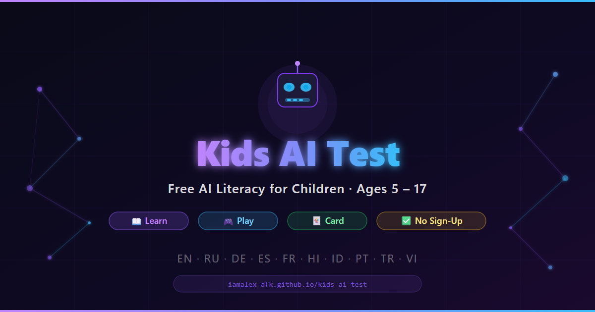

<p align="center">
  
</p>

<h1 align="center">Kids AI Test</h1>
<p align="center"><strong>Teaching kids how AI really works — no marketing, no fear-mongering, just the facts.</strong></p>

<p align="center">
  <a href="https://github.com/IamAlex-afk/kids-ai-test/actions/workflows/pages.yml"></a>
  <a href="LICENSE"></a>
  
  
  
</p>

<p align="center"><strong>🔗 Live: <a href="https://iamalex-afk.github.io/kids-ai-test/">iamalex-afk.github.io/kids-ai-test</a></strong></p>

---

## What it is

A free, installable PWA that teaches children ages 5–17 how AI actually works, through:

- **Age-adapted lessons** — four tiers (5–7 with an adult, 8–10, 11–13, 14+), each with its own vocabulary, pacing, and depth. For children under 5 there is guidance for parents, not a separate course.
- **A sourced quiz** — answers link to the sources they are based on (Stanford AI Index, the EU AI Act, peer-reviewed papers). Source coverage is not yet equal across languages.
- **Three mini-games** — Snake, a platformer, and a racing game, all reinforcing the same concepts through play
- **A keepsake result card** — rendered client-side, downloadable as an image. Its SHA-256 code is a fingerprint of the card's own fields, not a signature: it does not prove identity, uniqueness, or course completion.
- **Text-to-speech** — lessons can be read aloud for children who can't read yet

## Why this exists

Most "AI for kids" content is either a marketing pitch for an AI product, or vague fear-mongering. This is neither: it's a straight, age-appropriate explanation of what AI is, what it isn't, and how to think critically about it — built by a parent, reviewed against primary sources, with zero commercial angle.

## Features

- ✅ **10 language versions**: en, ru, de, es, fr, hi, id, pt, tr, vi. Depth and source coverage differ by language; native-speaker review is not complete.
- ✅ **No tracking, no accounts, no ads** — everything runs client-side. Progress stays in the browser tab by default; saving on the device only after an explicit choice (💾), with a delete button.
- ✅ **Installable PWA** — works offline after the first full load
- ✅ **Accessibility-conscious** — automated checks are not a full accessibility audit
- ✅ **Plain HTML/CSS/JS** — no framework, no bundler

## Tech stack

Vanilla JavaScript, HTML, CSS. No frameworks, no bundler. A small copy step (`tools/build.mjs`) puts only the public site files into `dist/`, which is what GitHub Pages publishes.

## Structure

```
index.html, {lang}.html     10 languages: en, ru, de, es, fr, hi, id, pt, tr, vi
js/core.js                  app logic — age selection, lessons, quiz, results
js/snake.js, platformer.js, racing.js   the three mini-games
js/card.js                  keepsake result card (local SHA-256 fingerprint, not a signature)
js/storage.js, storage-ui.js  tab-memory storage + explicit "save on this device" choice
js/companion.js, glossary.js, leaderboard.js, names.js, parents-faq.js
data/{lang}.js              per-language lesson/quiz content, with sources
css/main.css                all styling, age-based theming via [data-age]
assets/                     sprite art (CC0-licensed, see assets/CREDITS.md)
robots.txt, sitemap.xml, llms.txt, ai.txt   SEO / AI-crawler discoverability
manifest.json, sw.js        installable PWA with offline support
.well-known/security.txt, SECURITY.md
```

## Run locally

```bash
node tools/build.mjs          # copies the public site into dist/
python -m http.server 8080 --directory dist
# open http://localhost:8080
```

## Privacy

No accounts, no ads, no analytics, no cookies, and answers are not sent anywhere. Like any website, the host (GitHub Pages) receives ordinary page requests.

## License

GPL-3.0 — see [LICENSE](LICENSE). © 2026 Aleksei Sergeevich Bitkin.
